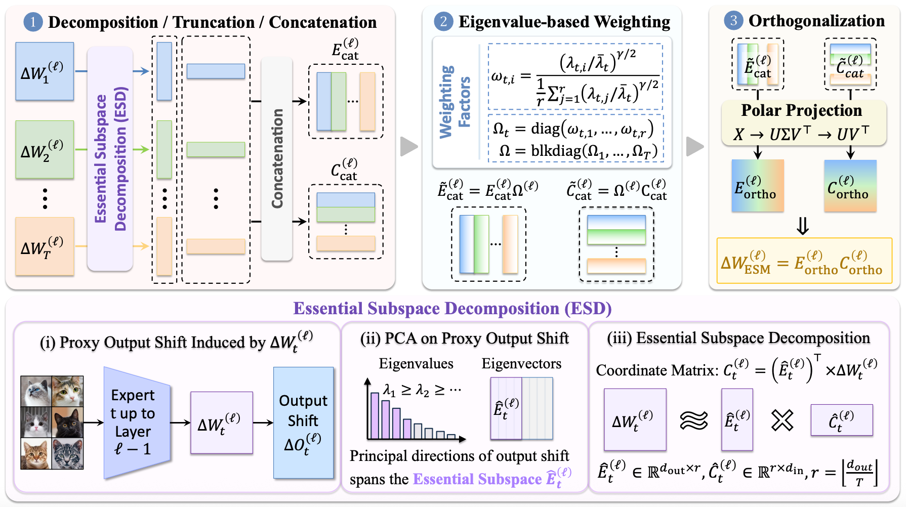
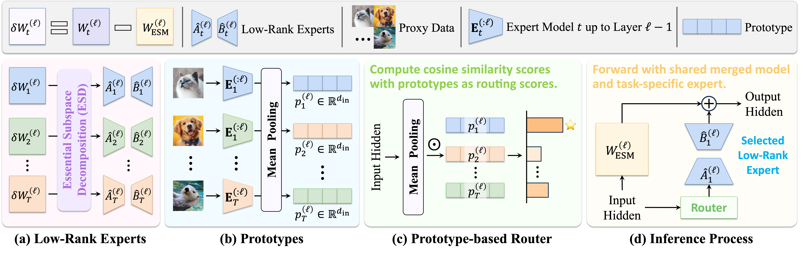
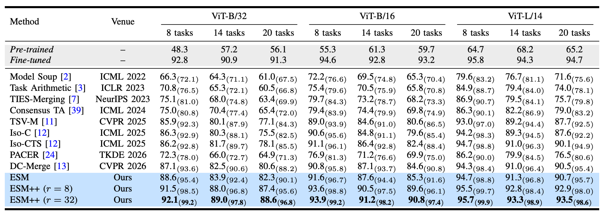
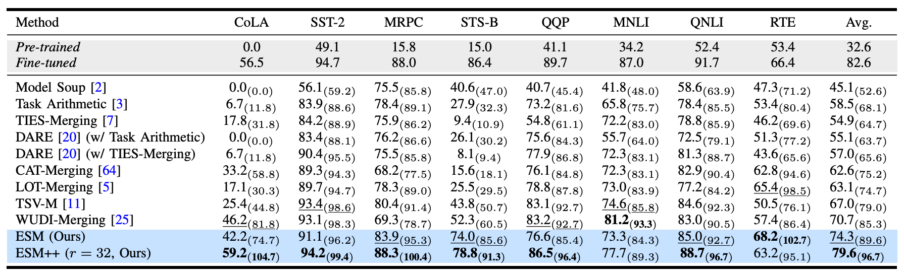
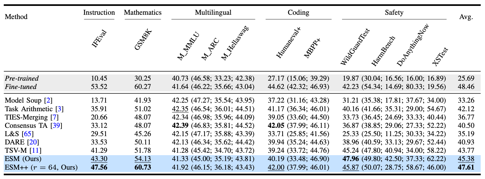

# Essential Subspace Merging

[ESM-ViT](ESM-ViT/) | [ESM-RoBERTa](ESM-RoBERTa/)

**ESM** (static merging) and **ESM++** (dynamic merging) are two training-free methods for merging multiple task-specific models into a single unified model. They require only a handful of unlabeled proxy samples (≤32 per task) — no retraining, no gradient-based optimization.

- **ESM**: compresses all experts into **one compact model** with single-model inference cost.

- **ESM++**: builds a lightweight **mixture of low-rank experts** on top of the ESM base, routing each input to the best expert via cosine similarity with pre-computed prototypes.


---


## Results


### Vision Model Merging (ViT)



### Discriminative Language Model Merging (RoBERTa-Base)



### Generative Language Model Merging (Llama-3.2-3B)



---

## Project Structure

```
ESM/
├── README.md
├── ESM-RoBERTa/           # NLP: RoBERTa on GLUE
│   ├── run_merge.py        # Main entry point
│   ├── merge.py            # ESM + ESM++ core algorithms
│   ├── esm_moe_eval.py     # ESM++ routing evaluator
│   ├── essential_subspace_decomposition.py
│   ├── search_scaling.py   # Alpha search for ESM
│   ├── prepare_validation.py
│   └── ...
└── ESM-ViT/               # Vision: ViT on visual benchmarks
    ├── esm.py / esmpp.py
    ├── essential_subspace_decomposition.py
    └── src/
```

## 📝 Citation
If you use this work in your research, please cite our paper:

```
@inproceedings{li2026model,
  title={Model merging in the essential subspace},
  author={Li, Longhua and Qi, Lei and Tian, Qi and Geng, Xin},
  booktitle={Proceedings of the IEEE/CVF Conference on Computer Vision and Pattern Recognition},
  pages={31145--31154},
  year={2026}
}
@article{li2026essential,
  title={Essential Subspace Merging for Multi-Task Learning},
  author={Li, Longhua and Qi, Lei and Geng, Xin and Tian, Qi},
  journal={arXiv preprint arXiv:2606.19164},
  year={2026}
}
```


## License

This project is released under the MIT License. See [LICENSE](ESM-ViT/LICENSE) for details.
